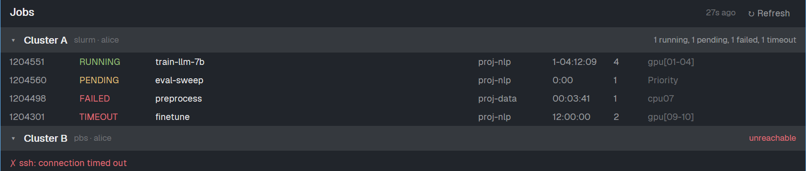

# Slurm Jobs

A right-hand side panel for the Herdr desktop app that lists your Slurm and
PBS/OpenPBS jobs, one collapsible section per cluster. A **Slurm** button in the
top bar, beside Files, Git and Skills, switches it on and off.

## What you see

- Header row: **Jobs** (14px, semibold), then "refreshing…" or "12s ago", then a
  `↻ Refresh` button.
- One section per machine in `machines.toml`: a raised bar with `▾`/`▸`, the
  machine name (13px semibold), `slurm · <user>` (dim) and a summary on the
  right (`1 running, 2 pending`, or `unreachable`, or `no jobs`).
- Under an open section, one row per job: job id, state, name, account,
  elapsed, nodes, and the pending reason (else the node list).
- Colors come from the theme: RUNNING ansi green (`ansi2`), PENDING/QUEUED/HELD
  ansi yellow (`ansi3`), FAILED/CANCELLED/TIMEOUT/NODE_FAIL/OUT_OF_MEMORY/
  PREEMPTED `blocked`, anything else `muted`.
- Narrow panels drop columns: below 640px the account, nodes and detail columns
  go; below 420px the reason/node list goes too.

## How it behaves

- Polls every 20 s and on `↻ Refresh`; clicking a machine bar folds it.
- An unreachable cluster or scheduler error shows `✗ <message>` in red inside
  its section; other clusters keep working.
- A missing `herdr-slurm` binary shows a hint instead of a blank panel.
- The panel is a `panel-body` stack child, so the top-bar button, the layout's
  per-space panel memory and `layout.select`/`layout.show` all work on it.

## Built from

- `mods/slurm/main.js`, `mod.json` (`{"place":"none"}`), `icon.svg`.
- `exec("herdr-slurm", ["snapshot"], {timeout: 60000})`: the Rust CLI in this
  repo queries every machine over SSH in parallel and prints
  `{error, warnings, machines:[{name, host, scheduler, user, error, fetched_at,
  jobs:[{id, name, state, elapsed, nodes, account, reason, where}]}]}`.
  Config is `machines.toml` in `herdr plugin config-dir ivan.herdr-slurm`.
- Props: `bin` overrides the executable (default `herdr-slurm` on PATH).
- `herdr` functions: `exec`, `theme`, `props`; `cx.timer.every`, `cx.spawn`,
  `on_size_change`.
- Layout: add `{ "id": "slurm", "type": "block", "content": { "mod": "slurm" } }`
  to the `panel-body` stack, and a top-bar button that runs
  `layout.select {stack:"panel-body", child:"slurm"}` then `layout.show {id:"panel"}`
  (and add `"slurm"` to the bar's list of enabled panels).

## Watch out

- The mod runs `ssh` (BatchMode, key auth, 15 s per cluster) via the binary.
  It reads no files and makes no network request of its own.
- Needs `cargo install --path .` (or a release build on PATH) first.
- Colors must come from `ansi2`/`ansi3`, not `working`/`done`: those are amber
  and blue in the default theme.
- Only a stack child of a layout's `panel-body` is a toggleable panel. The mod
  alone (`place: none`) shows nowhere until a layout or a tab (`tab.new --mod slurm`) hosts it.

## Done when

- `herdr-app check mods/slurm` passes.
- With a stub binary printing the JSON above, running, pending and failed jobs
  show in green, yellow and red, and a machine with `error` shows `unreachable`.
- With no binary, the panel shows the install hint.
- The top-bar Slurm button toggles the panel.
