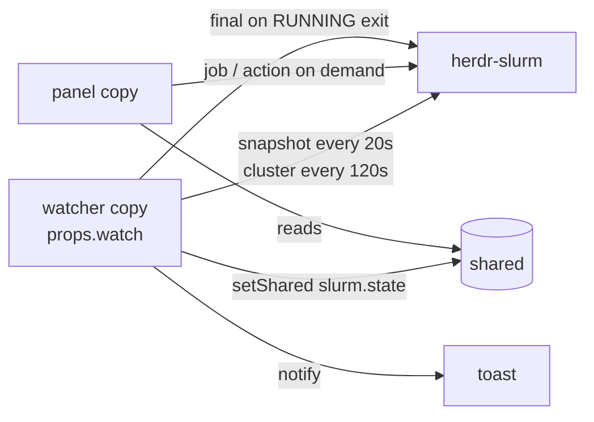

# Slurm mod extensions: design

Date: 2026-11-17. Status: approved in chat (design), awaiting spec review.

## Goal

Make the herdr-app `slurm` mod (`mods/slurm/`) the place where a researcher
notices and handles job problems: see a job's log and resource use, act on
it, get told when it ends badly, and see whether the cluster and the disks
have room.

## Scope

In scope:
- New `herdr-slurm` CLI subcommands that print JSON for the mod: `job`,
  `action`, `final`, `cluster`.
- One new optional `machines.toml` key per machine: `storage`.
- The mod: expandable job rows, actions, notifications, a per-machine
  cluster strip, one background watcher copy in the user's `main-quota`
  layout.

Out of scope (unchanged): the TUI pane (`herdr-slurm` with no args), the
`open`/`refresh`/`start`/`stop`/`daemon` subcommands, sidebar tokens,
`herdr-plugin.toml`, the existing `snapshot` JSON shape (fields may be
added, none removed).

## Observed cluster facts (read-only probe, 2026-11-17)

| | Perun (`login02.perun.tuke.sk`) | Devana (`login.devana.nscc.sk`) |
|---|---|---|
| `sinfo -N -O "NodeHost:\|,Partition:\|,Gres:\|,GresUsed:\|,StateCompact:\|"` | `gpu03\|gpu_short\|gpu:8\|gpu:6\|mix-\|` (untyped) | `n141\|gpu\|gpu:a100-sxm4:4\|gpu:a100-sxm4:1(IDX:1)\|mix-\|` |
| `sacct` | **fails** (accounting DB refused) | works |
| `scontrol show job -o` | works | works |
| Storage | `$HOME` nfs, `/mnt/scratch` lustre | `$HOME` nfs, `/scratch` nfs, `/project` lustre |
| `lfs quota -q -u $USER <p>` | `   /mnt/scratch  4  0  0  -  1  0  0  -` (limit 0 = none) | `/project 781156724 0 0 - ...` |
| `nvidia-smi` on login | absent | present |

Consequences: final job state comes from `scontrol show job` first (jobs
stay there for MinJobAge, default 300 s, longer than one 20 s poll) and
`sacct` only as fallback. A quota limit of 0 means "no quota": show the
filesystem fill only.

## CLI contracts

All subcommands read `machines.toml` like `snapshot`, address a machine by
its `name`, run exactly one `ssh` per machine (BatchMode, 8 s connect), cap
each machine at 30 s, and always print one JSON object on stdout with an
`error` field (`null` on success). Exit code is 0 unless arguments are
malformed (exit 2, JSON `error` still printed).

Job ids are validated before they reach a remote shell:
- Slurm: `^[0-9]+(_[0-9]+)?$`
- PBS: `^[0-9]+(\[[0-9]*\])?(\.[A-Za-z0-9.-]+)?$`
Anything else: `{"error":"invalid job id '<id>'"}`.

Scheduler tools resolve beside `scheduler_command`: when it contains a `/`,
`scancel`, `scontrol`, `sinfo`, `sstat`, `sacct`, `srun` (or `qdel`,
`qhold`, `qrls`, `qrerun`) are taken from the same directory; otherwise
bare names on the remote PATH.

### `herdr-slurm job <machine> <id> [--lines N] [--gpu]`

`N` default 50, clamped to 1..=500.

```json
{ "error": null, "machine": "Devana", "id": "123", "state": "RUNNING",
  "node_list": "n141", "start_time": "2026-11-17T10:02:11",
  "stdout": "/home/u/slurm-123.out", "stderr": "/home/u/slurm-123.out",
  "alloc": { "cpus": 16, "mem": "64G", "gpus": 4 },
  "out_tail": ["..."], "err_tail": ["..."],
  "steps": [{ "step": "123.batch", "ave_cpu": "01:02:03", "max_rss": "12G" }],
  "gpus": [{ "node": "n141", "index": 0, "util": 97, "mem_used_mib": 30000, "mem_total_mib": 40960 }],
  "gpu_error": null }
```

- Slurm: `scontrol show job -o <id>` gives StdOut, StdErr, NodeList,
  StartTime, JobState, AllocTRES (`cpu=16,mem=64G,gres/gpu=4`). Tails via
  `tail -n N` of each path; `err_tail` is `[]` when StdErr equals StdOut.
  `steps` from `sstat -a -n -P -j <id> -o JobID,AveCPU,MaxRSS` (empty when
  not running). `gpus` only with `--gpu` and state RUNNING: `timeout 25 srun
  --jobid=<id> --overlap --ntasks-per-node=1 sh -c 'nvidia-smi
  --query-gpu=index,utilization.gpu,memory.used,memory.total
  --format=csv,noheader,nounits | sed "s/^/$(hostname),/"'`; failure text
  goes to `gpu_error`, `gpus` is `[]`.
- PBS: `qstat -f <id>` (text form, read with `sed` in the same ssh call); `Output_Path`/`Error_Path` lose their
  `host:` prefix; no `steps`, no `gpus` (`gpu_error`: "not supported on
  PBS").
- An unreadable log file gives a single tail line `(cannot read <path>)`.
- Remote output is split by marker lines `@@herdr:<section>@@`.

### `herdr-slurm action <machine> <id> <cancel|requeue|hold|release>`

```json
{ "error": null, "ok": true, "output": "" }
```

Slurm: `scancel`, `scontrol requeue`, `scontrol hold`, `scontrol release`.
PBS: `qdel`, `qrerun`, `qhold`, `qrls`; PBS ids are single-quoted in the
remote command (array ids like `4021[7]` are glob patterns). Non-zero remote
exit gives `ok: false` and `error` = last stderr line. Any other verb is an
argument error.

### `herdr-slurm final <machine> <id>...`

```json
{ "error": null, "jobs": [{ "id": "123", "state": "OUT_OF_MEMORY", "exit_code": "0:125" }] }
```

Slurm: `scontrol show job -o <id>` per id (`JobState`, `ExitCode`); ids it
no longer knows go to one `sacct -n -X -P -j a,b -o JobID,State,ExitCode`;
ids neither knows get state `UNKNOWN`. `CANCELLED by 42` normalises to
`CANCELLED`. PBS: `qstat -x -f <ids>` text form (not `-F json`), `job_state`
F with `Exit_status` 0 maps to `COMPLETED`, other exit to `FAILED`, F
without `Exit_status` to `UNKNOWN`.

### `herdr-slurm cluster`

All machines in parallel:

```json
{ "error": null, "machines": [{ "name": "Devana", "error": null,
  "partitions": [{ "name": "gpu", "gpu_type": "a100-sxm4", "gpus_total": 32, "gpus_used": 21, "gpus_free": 11 }],
  "pending": [{ "id": "124", "start": "2026-11-17T14:00:00" }],
  "storage": [{ "path": "/project", "fs": "lustre", "size_kb": 10260689661504, "used_kb": 690311484500, "pct": 7,
                "quota": null }] }] }
```

- Partitions: from the `sinfo` line above, one row per (node, partition).
  Per partition, per GPU type (untyped `gpu:8` gives type `""`): total =
  sum of Gres counts, used = sum of GresUsed counts. Nodes whose state
  contains `down`, `drain`, `drng`, `fail`, `maint` or `resv` count to total;
  GPUs in use on them still count to `gpus_used`, only their free GPUs are
  withheld. `gpus_free = total - used - unavailable free`.
  Partitions with no GPUs are omitted. PBS machines: `partitions: []`.
- Pending: `squeue -u <user> -t PD --start -h -o "%i|%S"`; `N/A` gives
  `start: null`. PBS: `[]`.
- Storage paths: the machine's `storage` list, else `$HOME` plus whichever
  of `/scratch`, `/mnt/scratch`, `/project` exist. Per path: `stat -f -c %T`,
  `df -Pk`, and on `lustre` `lfs quota -q -u <user> <path>`. `quota` is
  `{used_kb, limit_kb, pct}` only when the hard limit (else soft) is > 0;
  otherwise `null`. A missing path is skipped.

### `machines.toml` addition

```toml
storage = ["$HOME", "/mnt/scratch", "/project/my-proj"]   # optional
```

Each entry must match `^[A-Za-z0-9_./~$-]+$` and contain no `..`; an
invalid entry skips the machine with a warning (same rule as other keys).

## Mod behaviour

### Data flow



- Exactly one copy polls: the leader. A copy becomes leader when
  `shared("slurm.leader")` is missing or its `at` is older than 60 s; the
  leader refreshes `{copy, at, watch}` every tick. Watcher copies
  (`props.watch`) are preferred: a watcher may take a fresh lease from a
  panel copy; a panel copy polls only when no lease is fresh, so the panel
  still works in layouts without a watcher.
- The leader publishes `shared("slurm.state") = {snapshot, cluster, failure,
  updated_at, running, armed}`. Every copy renders from it. A new leader
  adopts `running`/`armed` only when `updated_at` is < 120 s old, otherwise
  it reseeds. `↻ Refresh` asks the leader via
  `shared("slurm.refresh") = <timestamp>`.
- The watcher copy renders nothing (`div()`), in a zero-height block
  `{ "id": "slurm-bg", "type": "block", "size": {"px": 0}, "content": {"mod": "slurm", "props": {"watch": true}} }`
  added to `layouts/main-quota.json` beside `slack-bg`.

### Notifications

The leader keeps `running = Map<machine/id, name>` from the previous
snapshot. A job in that map that is absent from the new snapshot or is no
longer RUNNING/COMPLETING is collected; one `final` call per machine
resolves them. Then one `notify` per job:

| final state | level | sound |
|---|---|---|
| COMPLETED | `success` | none |
| FAILED, OUT_OF_MEMORY, TIMEOUT, NODE_FAIL, CANCELLED, PREEMPTED, BOOT_FAIL, DEADLINE | `error` | `playSound("blocked")` |
| UNKNOWN, anything else | `warning` | none |

Title `"<machine>: job <id> <STATE>"`, body `"<name> · exit <exit_code>"`.
The first snapshot after start only seeds the map (no notifications for
jobs that ended while the app was closed). A machine whose snapshot has
`error` keeps its previous map untouched (unreachable ≠ finished).
Storage: one `warning` notify when a path crosses ≥ 90 % (filesystem or
quota), again only after it has dropped below 85 %.

### Panel UI

- Job row click toggles an expanded block under it (one open per machine),
  which calls `job` with `--lines 50` and re-fetches every 20 s while open.
- Expanded block, top to bottom:
  1. Action bar: `Cancel` `Requeue` `Hold` `Release` (both schedulers; on
     PBS they map to `qdel`/`qrerun`/`qhold`/`qrls`), `Terminal on node`
     (Slurm, RUNNING only), `Open log in agent`, `GPU usage` (Slurm,
     RUNNING, alloc.gpus > 0). Cancel and Requeue ask first with an inline
     "Cancel job 123? Yes / No" row in the block. After an action: refresh.
  2. Facts line: node list, start time, `cpus · mem · N GPU`, step AveCPU /
     MaxRSS.
  3. GPU line (after `GPU usage`): one chip per GPU `n141#0 97% 30/40G`.
     Under-use flag in `ansi3`: `"2 of 4 GPUs busy"` when busy (util ≥ 10)
     < allocated.
  4. Log: tabs `out` / `err` (err hidden when same file), monospace,
     `settings().font_family`, max 50 lines, scrolled to bottom.
- `Terminal on node`: `run("tab.new", {name: "<id>@<machine>", argv:
  ["ssh", "-t", <ssh target>, "srun --jobid=<id> --overlap --pty bash -l"]})`.
  The ssh target comes from snapshot (`host`, plus new snapshot field
  `ssh_target`).
- `Open log in agent`: `run("tab.new", {name: "log <id>", argv: [props.agent
  ?? "claude"], task: <prompt>})`; prompt holds machine, ssh target, job id,
  state, log paths, the last 50 lines of out and err, and the request
  "Diagnose why this Slurm job failed or is misbehaving. Use ssh <target>
  to read more of the logs."
- Pending rows show `starts ~HH:MM` (or `Mon HH:MM` when not today) from
  `cluster.pending`, in place of the reason when known.
- Cluster strip under each machine header (hidden when collapsed): GPU
  chips per partition `gpu a100-sxm4 11/32 free` (green when free > 0,
  muted at 0), then storage bars `path 45%` (bar `ansi2` < 80, `ansi3`
  80–89, `blocked` ≥ 90; the higher of filesystem % and quota %).

## Error handling

- Every CLI failure surfaces as JSON `error`; the mod shows it inline in the
  section it concerns (expanded block, strip, toast for actions) and keeps
  the rest working.
- `job` on a job that has left the queue still works for MinJobAge; after
  that its `error` is shown in the block.
- Lease holder crash: another copy takes over after 60 s.

## Testing

- Rust unit tests (existing `mod tests` style): job id validation; tool
  path resolution; `scontrol -o` parsing incl. AllocTRES; sinfo GPU
  aggregation from the two probed line formats incl. drained nodes; `lfs
  quota -q` parsing incl. limit 0 and `*` suffix; `df -Pk` parsing;
  `final` state normalisation; section splitting; `storage` validation.
- Pure JS in `mods/slurm/logic.js`, tested with
  `node --test mods/slurm/logic.test.js`: ended-job
  detection incl. unreachable machine and first-snapshot seeding; GPU
  under-use flag; storage threshold hysteresis; start-time formatting;
  lease decision.
- Live: `herdr-slurm job|cluster|final` against Perun and Devana;
  `herdr-app check mods/slurm`; screenshot of an expanded row and the
  cluster strip.
